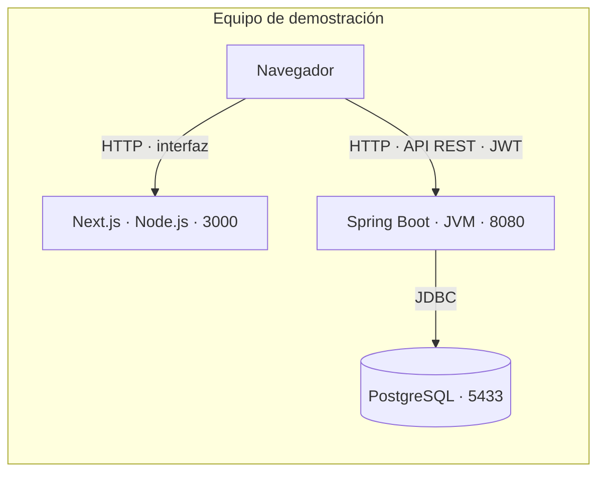

# Despliegue local

- El servidor Next.js entrega la interfaz en localhost:3000. El navegador consulta la API en localhost:8080/api.
- Spring Boot valida las sesiones de consultor y candidato y aplica las reglas de los casos de uso.
- PostgreSQL almacena preguntas, candidatos, evaluaciones y resultados. Docker Compose publica su puerto interno 5432 como 5433 en el equipo.

[Guía de ejecución](../README.md)
